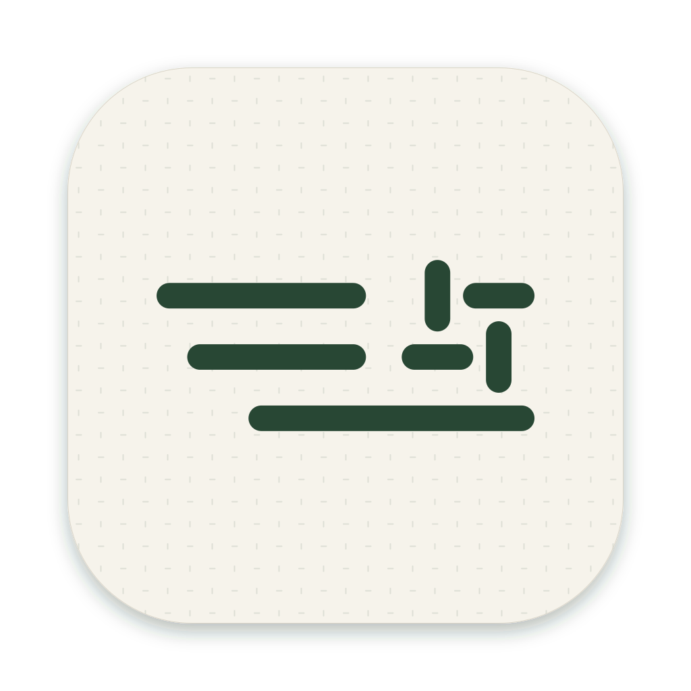

<p align="center">
  
</p>

<h1 align="center">Linen</h1>

<p align="center">
  A native macOS reader for Markdown and plain text. A Loom product.
  <br>
  In Arabic it is <em>سطر</em>, "line".
</p>

Linen opens the notes, plans, boards and PRDs you and your agents write, and keeps your place while they are rewritten under you. It reads; it never edits. Open in Editor hands the file to Obsidian or your editor of choice.

## New in Linen 2

- **Boards.** JSON Canvas files (`.canvas`, the format Obsidian uses) open as boards: sections, cards, stickies, shapes and connectors, a status word per box drawn as its own shape when zoomed out, a legend that works like find, notes with sources on hover, change marks per box, a List view, and right-to-left Arabic boards. Linen's own fields ride in a `linen` object that Obsidian keeps.
- **Loom blocks in notes.** Tiles, cards, steps, a bar, status words (`:w[Broken]`) and footnotes as cards, written as fenced YAML so the note stays readable anywhere.
- **For coding agents.** A `linen` command (`check`, `layout`, `shot`, `open`) and an MCP server (`linen mcp`) that Claude Code, Codex and other agents add once: they describe a board's sections and boxes and Linen lays it out, change boxes by id, check files, see them as Linen draws them, and open them without stealing focus. How to write for Linen: `docs/FORMAT.md`.
- **Export.** A board as a vector PDF with searchable text (Arabic included) or a PNG; a note as a PDF or one self-contained HTML file.

## What it does

- **Typeset reading.** Thmanyah faces, a 34-em text measure with tables, code and diagrams allowed to widen past it, Mermaid diagrams, KaTeX math, highlighted code, callouts, footnotes, task lists, and Obsidian wiki links and embeds.
- **Arabic and English together.** Direction is decided per block, the interface comes in Arabic, and find folds tashkeel, hamza forms, alef maqsura, taa marbuta and tatweel (with an option to turn it off).
- **Live reload that keeps your place.** Any writer can save the file: in place, atomic replace, Vim, `mv` over, coordinated writes. The block you were reading stays on the same line, and blocks that changed since you last looked get a thin mark. Next Change walks them.
- **Vault-aware.** Wiki links resolve the way Obsidian resolves them, Open Quickly (⇧⌘O) searches note names and aliases, and links outside the vault ask first.
- **Safe by construction.** The page has a literal content security policy with no network at all, local images are opened by descriptor inside the vault only, remote images load through the app on request, and every limit (size, tokens, pixels, nesting) is bounded.
- **Made for working with agents.** Copy Reference (⌥⌘C) copies `path:lines` and the quoted lines, ready to paste into a prompt.
- **Mac all the way.** Native tabs, session restore with each tab's place and text size, Paper and Night themes that follow the system, Quick Look in Finder, Print and Save as PDF with running titles and an outline.

## Build

Requirements: macOS 15 or later, Xcode 26, [XcodeGen](https://github.com/yonaskolb/XcodeGen).

```sh
make build     # Debug app in build/DerivedData
make run       # build and open it
make test      # LinenKit tests
make corpus    # render every note in ~/vault and the Ferry docs, report problems
make install   # Release build into /Applications
```

The Thmanyah faces are copied into the app at build time from `~/Library/Fonts`; without them Linen falls back to system faces. See `docs/BUILD.md`.

## Layout

| Path | What lives there |
| --- | --- |
| `Linen/` | The app: windows and tabs, menus, panels, printing, the link gate and the local and remote image handlers |
| `LinenKit/` | The model, tested on its own: vault index and link rules, file watcher, text decoding, place and baseline stores |
| `Renderer/` | The page: lexing in a worker, sanitising, rendering in slices, place keeping, change marks, find; the board model, view, layout and author; Loom blocks |
| `Tools/linen/` | The `linen` command and its MCP server |
| `LinenQuickLook/` | The Quick Look extension |
| `docs/PRD.md`, `docs/PRD-2.md` | The product: requirements, design contract, architecture, review logs and build logs (Linen 1, Linen 2) |
| `docs/FORMAT.md` | How agents write boards, notes and pages for Linen |
| `docs/research/`, `docs/spikes/`, `docs/reviews/` | What the PRD was built on |

Linen grew out of Satr 1.2.1, whose sources (`Sources/`, `Resources/`, `package.json`) are still in the tree for reference.
